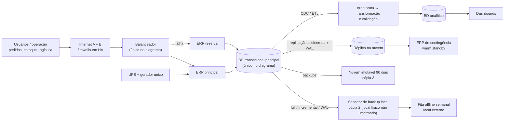
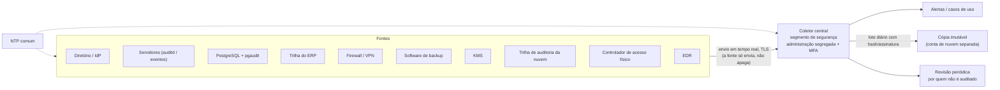

# Entregável 2 — Relatório de Auditoria de Segurança da Informação
## Reengenharia operacional proposta pela DeliMarket

**Consultoria:** Samir, Giovana e Emanuel · **Demandante:** equipe DeliMarket · **Data:** 09/11/2026 · **Versão:** 1.0 (minuta para revisão interna antes da reunião de 11/11)

**Documentos complementares:** [01 Inventário](01_inventario_documental.md) · [03 Matriz de riscos](03_matriz_riscos.md) · [04 Matriz de conformidade](04_matriz_conformidade_boas_praticas.md) · [05 Plano de ação](05_plano_de_acao.md) · [08 Perguntas](08_perguntas_para_delimarket.md)

---

## 0. Sumário executivo

**Pergunta central:** a reengenharia proposta pela DeliMarket é segura o suficiente para sustentar a operação da empresa?

**Resposta: ainda não.**

Como plano de **disponibilidade e recuperação contra falhas físicas**, que é o tipo de evento de 2023, a proposta é tecnicamente consistente e, em vários pontos, vai além do esperado:

- distingue replicação de backup;
- prevê PITR com WAL;
- prevê cópias imutáveis e *offline*;
- prevê testes mensais que incluem a decifragem;
- define metas por sistema;
- preocupa-se em evitar *split-brain*.

Como **arquitetura de segurança da informação**, porém, a proposta está incompleta. Ela trata a disponibilidade com profundidade, mas quase não trata ameaças intencionais: ransomware, comprometimento de credenciais, ataques originados nas estações, abuso de privilégio e vazamento de dados. Também não trata a governança que faz os controles funcionarem: papéis definidos, logs protegidos, resposta a incidentes e LGPD aplicada na prática.

As metas de **RPO de 5 minutos e RTO de 1 hora não têm evidência**. Elas são plausíveis apenas no cenário de perda física do data center e dependem de premissas que o documento não registra.

> Em uma frase: **a proposta prepara a DeliMarket para o incidente de 2023, não para o próximo.**

**Principais riscos** (detalhes no Entregável 3):

| ID | Risco | Nível atual |
|---|---|---|
| R01 | Ransomware que entra por uma estação (pendrive ou phishing), se espalha lateralmente e atinge servidores e backups | **Crítico (20)** |
| R06 | RTO de 1 h descumprido em um desastre no DC, por causa de dependências e critérios de acionamento não definidos | Alto (16) |
| R17 | Incidente de segurança sem plano de resposta, com contenção tardia, evidências destruídas e comunicação fora do prazo | Alto (16) |
| R02 | Uma credencial privilegiada roubada que permite apagar a réplica, a contingência, os backups e as chaves | Alto (15) |
| R04 | Banco de dados local como ponto único de falha (o texto e o diagrama se contradizem) | Alto (12) |

**Pontos fortes que devem ser preservados:** PITR com WAL; regra 3-2-1 complementada por cópia imutável de 90 dias e fita *offline*; testes mensais e trimestrais com decifragem; AES-256-GCM e TLS 1.3; BI separado do banco transacional, com carimbo de atualização e reconciliação; consciência dos limites da replicação e dos custos.

**O que falta para a proposta ficar "suficientemente segura":**

- **Dez medidas imediatas**, quase todas de baixo custo: papéis e RACI; critérios para declarar desastre; MFA e contas administrativas separadas; isolar as credenciais e a administração do backup e da nuvem, com imutabilidade em modo conformidade e WAL imutável; bloquear USB; guardar as chaves *offline*; completar o escopo do backup.
- **Onze medidas de curto prazo:** BIA, segmentação da rede, EDR e gestão de patches, logs centralizados e protegidos, gestão de identidades, plano de resposta a incidentes, programa mínimo de LGPD, plano formal de backup e governança da nuvem.

Com essas medidas, nenhum dos 18 riscos mapeados permanece nos níveis alto ou crítico (projeção no Entregável 3). A abordagem é gradual e proporcional, sem exigir uma arquitetura idealizada.

---

## 1. Escopo, objetivos e limitações de escopo

- **Objeto:** a proposta "Plano de Continuidade de Negócios, Redundância e Governança de Dados — DeliMarket" (PDF de 22 páginas), dois diagramas enviados como JPEG em 04/11/2026, o estudo de caso que originou a proposta e a transcrição da reunião de 04/11/2026.
- **Objetivo:** avaliar como a reengenharia afeta a segurança da informação (confidencialidade, integridade, disponibilidade, autenticidade e conformidade), identificar riscos e lacunas e propor adequações viáveis para o negócio.
- **Natureza da avaliação:** é uma **auditoria documental de desenho** (*design review*). A proposta é um plano. Por isso, avaliamos se cada controle está **adequadamente especificado**, e não se ele **funciona na prática**. Não houve teste técnico, entrevista estruturada nem acesso a ambiente. A empresa é fictícia e o contexto é acadêmico.
- **Fora do escopo:** custos absolutos (não há dados financeiros), validação jurídica definitiva (as indicações legais são referências a confirmar com o jurídico) e testes de invasão.

## 2. Metodologia

**Fases:** reconhecimento do conjunto documental (Entregável 1) → reconstrução da arquitetura → confronto com os PDFs de boas práticas (Entregável 4) → avaliação por domínio → classificação dos controles → análise de riscos (ISO/IEC 27005, Entregável 3) → recomendações com viabilidade (Entregável 5).

**Convenções usadas no texto:**

| Rótulo | Significado |
|---|---|
| **Evidência** | Trecho, diagrama ou fala identificável. Formato: `[Proposta §x, p. y]`, `[Diagrama 1]`, `[Reunião, fala de Fulano]`, `[Estudo de caso §n]` |
| **Constatação** | Conclusão sustentada pela evidência |
| **Lacuna documental** | Informação que não foi apresentada. **Não significa** que o controle inexiste |
| **Hipótese** | Possibilidade plausível que precisa ser confirmada (ver perguntas no Entregável 8) |
| **Recomendação** | Medida proposta pela consultoria (IDs AC01–AC34 no Entregável 5) |
| **Referência externa** | Norma, lei ou documentação que **não está** entre os PDFs da pasta |

**Critérios de classificação dos controles:** Adequado / Parcialmente adequado / Inadequado / Não evidenciado / Não aplicável, conforme as definições do termo de referência. Regras adotadas:

1. "Inadequado" só é usado quando a medida descrita **não atende ao objetivo** ou **conflita** com outra parte da proposta. Nunca é usado por mera falta de detalhe.
2. Lacunas transversais (papéis, proteção de logs) são avaliadas **nos seus próprios controles**, para não penalizar repetidamente os demais.
3. Uma diretriz correta mas sem especificação recebe "Parcialmente adequado". Algo que não é mencionado recebe "Não evidenciado".
4. As lacunas que a própria DeliMarket admitiu na reunião estão marcadas como **lacuna de desenho confirmada**.

**Escala de risco:** Probabilidade (1–5) × Impacto (1–5), com análise qualitativa, justificada pela ISO/IEC 27005, 8.3.1 a) quando faltam dados numéricos, e pela fórmula Risco = Impacto × Probabilidade dos slides de SGSI. A definição dos níveis está no Entregável 3.

---

## 3. Contexto e análise de causa raiz do incidente de 2023

**Contexto** `[Estudo de caso §1]`: a DeliMarket distribui alimentos perecíveis em todo o país. O ERP cobre pedidos, estoque, faturamento, compras e logística. O BI acompanha prazo de entrega, giro de estoque, perdas por validade e previsão de demanda. Todos os servidores ficam em um único data center próprio. Como os produtos são perecíveis, qualquer interrupção afeta diretamente as entregas, a qualidade e o faturamento.

| Sintoma relatado `[Estudo de caso §2]` | Causa imediata provável | Causa raiz (hipótese, salvo indicação) | Tratado pela proposta? |
|---|---|---|---|
| ERP indisponível por 18 h | Pane elétrica sem energia alternativa suficiente | DC único, sem DRP, sem análise de riscos nem BIA | **Sim**: UPS, gerador e contingência em nuvem (§3–4) |
| Perda de pedidos registrados antes da falha | Restauração a partir de um backup antigo (evidência); possível desligamento abrupto | Falta de arquivamento contínuo dos logs de transação; falta de desligamento ordenado; possível cache de escrita sem proteção | **Sim** (WAL/PITR, §5.1). **Não** quanto ao desligamento ordenado via UPS |
| Backup mais recente corrompido | Falha que não foi detectada | Sem verificação de integridade, sem teste de restauração, sem monitoramento e sem responsável definido | **Sim** (verificação, alertas, testes, §5.6). **Falta** responsável e registro de evidências |
| Uso de um backup "muito antigo" | Não havia cópias intermediárias válidas | Estratégia e retenção inadequadas | **Sim** (full, incremental, WAL e retenções, §5.2) |
| BI indisponível ou desatualizado durante a crise | Dependência do ERP e ausência de indicador de atualidade | BI sem desenho de continuidade e qualidade | **Sim** (carimbo de atualização e reconciliação, §8). **Parcial** quanto à continuidade do próprio BI |
| Entregas paralisadas e clientes sem atendimento | Não havia procedimento manual de contingência | O "PCN" se resumia à TI | **Parcial** (achado A23) |

**Conclusão:** a proposta ataca bem as causas técnicas do incidente de 2023. Duas causas de fundo, porém, ficaram de fora: a governança (papéis e gestão de riscos) e a cultura de teste com evidência registrada. Além disso, a própria reengenharia **cria superfície de ataque nova**: ambiente em nuvem, replicação contínua, conexões entre o local e a nuvem, um provável acesso remoto e um KMS. Isso exige controles de segurança que acompanhem a mudança.

---

## 4. Arquitetura proposta (reconstrução)

### 4.1 Diagrama reconstruído a partir do texto e do Diagrama 1



### 4.2 Ativos e processos relevantes

| Ativo | Processo apoiado | Propriedade mais crítica | Observação |
|---|---|---|---|
| BD transacional (PostgreSQL **presumido**, §5.1) | Pedidos, estoque, faturamento e logística | Integridade e disponibilidade | Único no diagrama |
| Servidores de aplicação do ERP (N+1) | Todos os processos | Disponibilidade | Ativo-passivo (§4.3) |
| Balanceador, firewalls, links A/B e switches | Acesso ao ERP | Disponibilidade | Firewalls em HA; balanceador único no diagrama |
| UPS, gerador com ATS e circuitos | Todo o DC | Disponibilidade | Gerador único |
| Servidor de backup local, fitas e cofre externo | Recuperação | Integridade e confidencialidade | Local físico do servidor não informado |
| Nuvem: réplica, ERP de contingência, armazenamento imutável e KMS | DR e retenção | Disponibilidade, integridade e confidencialidade | Provedor, região e modelo de contas não informados |
| CDC/ETL, BD analítico e dashboards | Decisão gerencial | Integridade e atualidade | Extração a partir do banco principal (Diagrama 1) |
| Estações de trabalho e (hipótese) dispositivos móveis de logística | Operação diária | Integridade e confidencialidade | **Ausentes da proposta** |
| Identidades: diretório, contas administrativas e contas de serviço | Acesso a tudo | Confidencialidade e integridade | **Ausentes da proposta** (hipótese: AD ou IdP) |
| Informações: clientes, fornecedores, funcionários, pedidos, operações financeiras (§11) | Todos | Confidencialidade (LGPD) | Sem classificação definida |

**Dependências externas:** concessionária de energia; dois provedores de internet; provedor de nuvem; fornecedor do ERP (hipótese); SEFAZ para a NF-e (hipótese forte, já que há "faturamento" de mercadorias no Brasil); manutenção do gerador e fornecimento de combustível; transporte e guarda das fitas.

### 4.3 Inconsistências identificadas na própria proposta (detalhe no achado A22)

1. Balanceador ativo-ativo (§3.3.1) × cluster ativo-passivo (§4.3).
2. Banco com réplicas (§4.2, §4.5) × banco único (Diagrama 1).
3. "Balanceadores" no plural (§4.1) × balanceador único (Diagrama 1).
4. Metas de RPO/RTO para logística e arquivos administrativos (§6.3) sem nenhum mecanismo correspondente (§5.2).
5. RPO de 1 h para o BI × backup diário do BI (§5.2).

---

## 5. Pontos positivos (com evidência)

| # | Ponto forte | Evidência |
|---|---|---|
| P1 | Afirma explicitamente que **replicação não é backup** e que a replicação propaga exclusões e alterações indevidas | `[Proposta §4.5, p. 7; §6.4, p. 14]` |
| P2 | Afirma que RAID não substitui backup | `[§4.5, p. 7]` |
| P3 | PITR com arquivamento contínuo de WAL e um exemplo de restauração coerente com o PostgreSQL | `[§5.1, p. 7; §5.5, p. 11]` |
| P4 | 3-2-1 mais cópia **imutável** de 90 dias mais fita **offline** criptografada. No desenho, equivale à regra 3-2-1-1-0 | `[§5.3–5.4, p. 9–10]`; critério: `3-2-1-1-0.txt` |
| P5 | Testes mensais de restauração e trimestrais de recuperação, **incluindo a decifragem** | `[§5.6, p. 11; §11.3, p. 20]` |
| P6 | RPO/RTO por sistema e reconhecimento de que a replicação assíncrona não garante 5 min e de que ransomware exige restauração com mais tempo | `[§6.1, §6.3, §6.4, p. 12–14]` |
| P7 | Prevenção de *split-brain* e *failback* controlado com sincronização e validação | `[§3.3.2–3.3.3, p. 3]` |
| P8 | Energia em camadas: UPS N+1, gerador com ATS, fontes duplas em circuitos independentes e, se tudo falhar, migração para a nuvem | `[§4.4, p. 6]` |
| P9 | Dois provedores com rotas distintas, firewalls em HA e reconhecimento de que o *failover* depende de DNS e autenticação | `[§4.1, p. 3]` |
| P10 | AES-256-GCM (modo autenticado), TLS 1.3, chaves separadas dos dados e reconhecimento de que criptografia não garante disponibilidade | `[§11, p. 19–21]` |
| P11 | BI separado do banco transacional: CDC/ETL, deduplicação, reprocessamento, horário da última atualização e reconciliação após a recuperação | `[§8, p. 16]` |
| P12 | Ciclo de vida dos dados: minimização, tabela de temporalidade, apagamento criptográfico, anonimização e o conflito entre **backup imutável e eliminação** | `[§9, p. 17–18]` |
| P13 | Consciência de custo: *warm standby* em vez de ativo-ativo e gerador único justificado | `[§3.2; §4.4; §6.6]` |

> Ao apresentar, devemos reconhecer esses pontos explicitamente. São decisões tecnicamente corretas e a consultoria **não** recomenda trocá-las.

---

## 6. Constatações por domínio

Cada achado indica os riscos afetados (R, Entregável 3) e as ações recomendadas (AC, Entregável 5).

### 6.1 Governança e gestão de riscos

#### A01 — O diagnóstico de riscos se limita à disponibilidade · R01, R02, R09, R10, R18 · AC08, AC12, AC30

**Evidência:**
- O §2 (p. 1) organiza os riscos em quatro categorias: energia, servidores, rede e dados. Ameaças cibernéticas e acessos não autorizados aparecem apenas em uma frase, sem análise.
- O §7.4 (p. 16) resume a "segurança lógica" em um único parágrafo.
- O Diagrama 2 não mostra endpoints, rede nem resposta a incidentes.
- **Reunião:** Emanuel lembrou do pendrive malicioso e observou que o exercício era "tendencioso" para a parte elétrica. João respondeu que "talvez não tá tão seguro os dados em si".

**Constatação:**
- A identificação de riscos não cobre as ameaças **intencionais**, embora a ISO/IEC 27005, 8.2.3, peça a identificação de ameaças acidentais e intencionais por classe.
- Não há estimativa de probabilidade e impacto (8.3) nem critério de aceitação de riscos (7.2.4).
- Resultado: muitos controles de disponibilidade e apenas menções genéricas a confidencialidade e integridade.

O material FEBRABAN da disciplina lista falhas de TI, falta de energia e ciberataques entre as causas frequentes de disrupção `[ativos riscos.pptx, slide 4]`. A próxima interrupção não precisa ser elétrica.

#### A02 — Faltam papéis, responsabilidades e governança · transversal (R03, R06, R11, R17) · AC01

**Evidência:**
- A proposta só usa termos genéricos: "a equipe", "os responsáveis", "equipe responsável" (§5.5, §6.2, §7.2). Nenhuma função é definida.
- **Reunião:** Emanuel perguntou qual setor cuidaria do backup, quem teria autorização, quem testaria e onde as cópias ficariam. A resposta foi: "a gente tem que olhar um pouco melhor depois". **Lacuna de desenho confirmada.**

**Critério:**
- TCU p. 34 (3.5): o PCN deve indicar responsáveis, suplentes e contatos.
- TCU p. 35 (3.6): papel e orçamento da alta administração.
- NC-03, art. 27 e anexo (itens 7 e 11): atribuições, responsáveis e assinaturas.
- Modelo de PSI, arts. 18 e 21: comitê, gestor de SI, ETIR e encarregado.
- `conteudo.pptx` (slide 12) mostra dois organogramas: a SI como diretoria própria e a SI subordinada à TI. A preferência pela **independência** é uma inferência da consultoria: evita que quem opera seja também quem fiscaliza.

**Constatação:** sem papéis definidos, os controles centrais não funcionam. Não se sabe quem declara o desastre, quem aprova uma restauração, quem guarda as chaves, quem administra os logs (e não pode ser alguém auditado por eles) nem quem notifica a ANPD. Também não é possível verificar a segregação de funções.

**RACI proposta** (R = executa, A = aprova/responde, C = consultado, I = informado):

| Atividade | Diretoria | Gestor de SI | Coordenador de crise (dono do PCN) | Gerente de infraestrutura | DBA | Administrador de backup | Custodiantes de chaves (2 pessoas) | Encarregado (LGPD) | Jurídico/Comunicação |
|---|---|---|---|---|---|---|---|---|---|
| Declarar desastre e acionar o DR | I | C | **A/R** | R | C | I | – | I | I |
| Executar *failover*/*failback* | I | I | A | R | R | C | – | – | – |
| Aprovar restauração de dados | – | C | **A** | C | C | R (executa após aprovação) | – | C (se houver dados pessoais) | – |
| Custodiar e recuperar chaves | – | A | I | – | – | – | **R (dupla custódia)** | – | – |
| Administrar a plataforma de logs | – | **A/R** | – | – | – | – | – | – | – |
| Revisar acessos (trimestral/semestral) | I | A | – | R (infra) | R (BD) | – | – | C | – |
| Notificar ANPD e titulares | A | C (insumos técnicos) | C | C | – | – | – | **R** | R |
| Comunicar clientes durante a crise | A | C | R | – | – | – | – | C | R |

> **Segregação:** quem administra infraestrutura, banco ou backup **não** deve administrar a plataforma de logs. Se a equipe for pequena, use os controles compensatórios descritos na seção 8.4.

#### A03 — RPO/RTO definidos sem BIA e sem análise por cenário · R06, R07 · AC12

**Evidência:**
- §6.3 (p. 13): "Esses tempos são metas propostas e deverão ser avaliados considerando os custos".
- **Reunião** (Wesley): "não tem como saber se essa seria a métrica aceitável em qualquer tipo de ocorrência [...] uma meta geral".

**Critério:** TCU p. 33 (3.4), que pede avaliar as consequências da interrupção de cada sistema, priorizar, definir o tempo limite e comparar alternativas por custo e benefício. Também NC-03, arts. 7º e 8º.

**Constatação:**
- Os valores podem estar certos, mas nada demonstra que são **necessários** (quanto tempo a operação de perecíveis tolera sem o ERP?) nem **suficientes**.
- Não há objetivo definido para corrupção lógica nem para ransomware, embora a própria proposta reconheça que esses cenários são mais lentos.
- "Serviços de logística" e "arquivos administrativos" têm metas sem nenhum mecanismo correspondente.

**Hipótese:** o tempo máximo tolerável de interrupção (MTPD) da expedição noturna pode ser de poucas horas. Se for maior, um RTO de 1 h pode estar superdimensionado e caro. Se for menor, a operação precisa de contingência manual (A23).

### 6.2 Infraestrutura, continuidade e ambiente físico

#### A04 — O banco de dados local é um ponto único de falha, e o texto contradiz o diagrama · R04 · AC22, AC08

**Evidência:**
- §4.2 (p. 4): "O banco de dados deverá ter redundância própria, com uma instância principal e réplicas".
- §4.5 (p. 7): "poderá ser utilizada replicação síncrona".
- No Diagrama 1 há um único "Banco transacional principal", e os dois servidores do ERP apontam para ele.
- §4.3 (p. 5): os dois servidores precisam de "acesso aos dados necessários", o que sugere armazenamento compartilhado (hipótese).

**Constatação:**
- O N+1 protege apenas a camada de aplicação. Se o servidor ou o armazenamento do banco falhar, o ERP para.
- Nesse caso, restam duas saídas: restaurar localmente, o que leva horas, ou acionar o *failover* completo para a nuvem, uma operação pesada que depois exige *failback*.
- O objetivo do §3.1, "suportar falhas individuais sem interromper toda a operação", não é atingido na camada de dados.
- Se o armazenamento for compartilhado, ele também é ponto único de falha. O balanceador aparece como único no diagrama, embora o §4.1 fale em "balanceadores".

#### A05 — As redundâncias estão sujeitas aos mesmos riscos físicos; o gerador é único · R05, R16 · AC24, AC01

**Evidência:**
- Diagrama 1: "UPS + gerador único".
- §4.4 (p. 6): a proposta opta por evitar "o investimento imediato em múltiplos geradores".
- O local físico do servidor de backup não é informado (§5.3). O termo "backup local", usado no diagrama e na reunião, indica o mesmo site (hipótese).

**Critério:**
- TCU p. 66: Acórdão 1722/2008, item 9.1.1.17, que exige que os recursos redundantes "não estejam sujeitos aos mesmos riscos físicos e ambientais" (17799, 9.1.4 b).
- 17799, 9.1.4 b) (p. 3): mídia de backup "a uma distância segura".
- 17799, 9.2.2 (p. 5): gerador verificado e testado, plano para falha do UPS e múltiplas fontes de energia.

**Constatação:**
- Servidores 1 e 2, banco, rede e, provavelmente, backup local compartilham o mesmo prédio, a mesma zona de incêndio e o mesmo gerador. Em um evento que atinja o site inteiro, a nuvem passa a ser o **único** caminho de recuperação, o que aumenta a importância do achado A06.
- A escolha do gerador único é defensável pelo custo, e a proposta tem o mérito de justificá-la. Mesmo assim, ela precisa ser **formalmente aceita como risco** (ISO 27005, 9.3), com compensações:
  - testes periódicos sob carga;
  - contrato de fornecimento de combustível;
  - ponto de conexão rápida para gerador alugado;
  - **desligamento ordenado comandado pelo UPS**, para evitar a corrupção de dados vista em 2023 (a proposta não menciona esse item).

#### A06 — O RTO de 1 h não foi decomposto em etapas nem considera critérios de acionamento ou dependências · R06, R15 · AC02, AC10, AC23, AC29

**Evidência:**
- §6.2 (p. 13): cinco etapas e "meta é que esse processo seja concluído em até 60 minutos", com a ressalva correta de que o processo deve ser "documentado, parcialmente automatizado e testado".
- §3.3.2: redirecionamento "por exemplo, por DNS".
- §6.4: o exemplo de 40 minutos é ilustrativo.

**Lacunas documentais:**
- quem decide o *failover* e com qual critério;
- capacidade da contingência ("sem necessariamente operar com toda a capacidade", §3.2);
- identidade (diretório e autenticação) disponível na nuvem;
- TTL do DNS;
- como os usuários e as filiais alcançam a nuvem;
- certificados digitais;
- integrações (SEFAZ, transportadoras e bancos, por hipótese);
- licenciamento do ERP na nuvem;
- **monitoramento localizado fora do DC**: se ele roda dentro do data center que caiu, ninguém é alertado.

**Critério:**
- TCU p. 34: condições de ativação, instalação reserva especificada e dependências externas.
- `ativos riscos.pptx`, slide 7: gatilhos de acionamento.
- Referência externa: NIST SP 800-34.

**Constatação:** o roteiro está correto, mas o RTO ainda é apenas uma meta. Em uma pane como a de 2023, decidir pelo *failover* não é trivial: se a energia voltar em 30 minutos, o *failover* terá criado trabalho de *failback* sem necessidade. Para caber em 60 minutos, é preciso ter critério objetivo e um decisor já autorizado. A seção 7.5 decompõe o tempo por etapa.

#### A23 — O "PCN" trata quase só de TI e falta continuidade operacional do negócio · R06 · AC02, AC10, AC12, AC29

**Evidência:**
- As seções 3 a 6 tratam de recuperação técnica, ou seja, de um DRP.
- Nada descreve como o armazém e a logística operam com o ERP fora do ar.
- Em 2023 houve "paralisação das entregas e clientes sem atendimento" `[Estudo de caso §2]`.

**Critério:**
- TCU p. 33 (3.3): o PCN prevê "serviços temporários ou com restrições" para as necessidades mais críticas.
- TCU p. 35–36: treinamento e testes com simulação.
- FEBRABAN (`ativos riscos.pptx`), slides 6 e 7: categorização e gatilhos.
- Referência externa: ISO 22301.

**Constatação:** mesmo com um DR perfeito, há minutos ou horas sem sistema, e em um ransomware podem ser dias. A operação precisa de procedimentos manuais já treinados:

- listas de separação impressas para as próximas rotas;
- registro de pedidos por planilha ou telefone, com reconciliação posterior;
- prioridade para os perecíveis por data de validade;
- contingência fiscal de emissão;
- roteiro de comunicação com os clientes.

### 6.3 Banco de dados

O achado A04 trata da redundância. Esta seção trata do **controle de acesso e da auditoria do banco**, que não aparecem na proposta.

- **Lacunas documentais:** contas e funções do banco (aplicação, BI, DBA); autenticação; quem pode fazer alterações diretas; registro das operações privilegiadas; integridade dos dados (*checksums*); criptografia em repouso.
- **Critério:**
  - TCU p. 70: evitar alterações diretas na base de produção (Acórdão 2023/2005, item 9.4.9).
  - TCU p. 77–78: registrar o acesso direto de administradores e manter trilha com data e hora, dado alterado e responsável.
  - TCU p. 85: privilégios mínimos para cada usuário do banco.
  - TCU p. 89: procedimentos formais para operações com utilitários.
- **Constatação:** é no banco que estão os dados mais críticos e regulados. Sem contas segregadas e sem auditoria, uma alteração de estoque ou de preço não deixa rastro confiável.
- **Recomendação:** AC26 (auditoria do banco e acesso privilegiado proporcional) e AC27.

### 6.4 Backup e recuperação

Resumo dos achados. A análise técnica completa está na seção 7.

#### A07 — Não há separação das credenciais e dos planos de administração entre produção, contingência, backup e chaves · R02, R01, R12 · AC03, AC04, AC06, AC21

**Evidência:**
- "Controle de acesso independente" só é previsto para o servidor de backup local (§5.3).
- A cópia é imutável, mas a proposta não diz em que modo nem quem a administra (§5.4).
- O KMS não tem localização definida (§11.3).
- Não há nada sobre contas na nuvem, IAM ou MFA no console.

**Critério:**
- `3-2-1-1-0.txt`: credenciais de backup independentes das de produção, com MFA, e cópia que não pode ser alterada "nem com credenciais de admin".
- `psi1.txt` (TCU): "AD: por onde o ransomware acontece".
- TCU p. 18: acesso a recursos críticos restrito a poucas pessoas.

**Constatação:** se uma mesma identidade administra produção, réplica, contingência, cofre de backup e KMS (por exemplo, um administrador do domínio federado com a nuvem), **uma única credencial roubada destrói todos os caminhos de recuperação**. O atacante pode:

- apagar a réplica e a contingência;
- reduzir a retenção ou apagar backups, se a imutabilidade puder ser contornada;
- agendar a exclusão das chaves;
- só então cifrar a produção.

Sobraria a fita *offline*, que pode ter até uma semana. O RPO real seria de dias.

> **Nuance técnica:** um ransomware que cifra arquivos no servidor primário **não** é replicado como tal pela replicação física do PostgreSQL. O fluxo de WAL transporta alterações do banco, não alterações de arquivos do sistema operacional. A réplica pode, portanto, ficar íntegra, **desde que** o servidor e as credenciais dela não tenham sido comprometidos. O controle decisivo é a **separação de credenciais**, não a replicação em si.

#### A08 — O arquivo de WAL não tem imutabilidade declarada · R01, R07 · AC04

**Evidência:**
- O WAL é "arquivado em armazenamento separado" (§5.1).
- A imutabilidade é aplicada à "nova cópia de backup" diária (§5.4).

**Constatação:** o PITR depende da cadeia contínua de WAL desde o último backup-base. Se o atacante conseguir apagar o arquivo de WAL, a cópia imutável diária só permite voltar até o momento em que foi feita. Isso pode significar **até 24 h de perda em um ransomware**, e não 5 min. É uma lacuna documental: a imutabilidade pode estar prevista, mas não está escrita.

#### A21 — A política de backup é tecnicamente boa, mas não tem governança e o escopo está incompleto · R03, R06 · AC20, AC07

**Evidência:**
- A tabela do §5.2 cobre apenas o ERP e o BI.
- Não há janela de backup, estratégia por sistema, responsável, assinatura nem autorização para restaurar.
- Não há leitura periódica das fitas nem um *drive* de fita disponível depois de um desastre no site.

**Critério:**
- NC-03, art. 16 (conteúdo do plano), art. 23 (local seguro), arts. 24–25 (testes em servidor diferente da produção), art. 27 (atribuições, inclusive gerenciar os logs do backup) e anexo (assinaturas).
- TCU p. 73 (incluir código e base), p. 74 (mídias fora do local) e p. 68 (fitas em ambiente restrito).
- `psi1.txt`: eixos de política, planos, testes, segurança física, segurança lógica e recursos.

**Constatação:**
- A política **técnica** (o que copiar e com que frequência) é forte. A política de **gestão** (quem faz, quem autoriza, que evidência fica e qual o escopo) não existe.
- Faltam no escopo itens essenciais para o DR:
  - diretório de identidades;
  - DNS e DHCP;
  - configurações de rede e de firewall;
  - modelos de máquinas virtuais;
  - binários e configurações do ERP;
  - certificados;
  - código das integrações e do ETL;
  - **runbooks em cópia offline** (se o DC cair, a wiki com o procedimento pode cair junto).
- **Restaurar é acessar dados.** A restauração pode ser usada para exfiltrar informação, por isso precisa de aprovação e de registro.
- A fita *offline* só tem valor se houver um **drive** disponível depois de um desastre no site. Hoje, o drive está no próprio DC.
- **Retenção:** a cópia de arquivamento de 12 meses "conforme obrigações legais" não deve ser o mecanismo de guarda legal. A retenção fiscal, em geral de pelo menos 5 anos (referência externa: CTN, art. 195, parágrafo único, a validar com a contabilidade), deve ser cumprida pelo **arquivamento de registros**, não pelo backup. Os dois conceitos precisam ficar separados. A NC-03 (art. 11) prevê cópia anual com 5 anos de retenção para sistemas críticos, o que serve como parâmetro.

### 6.5 Criptografia e gestão de chaves

#### A09 — O algoritmo é adequado, mas o ciclo de vida das chaves está incompleto, há dependência circular com a nuvem e a criptografia em repouso do banco não foi definida · R12, R10 · AC06, AC21, AC08

**Evidência:**
- AES-256-GCM é preferido (§11.1).
- A criptografia é aplicada a backups, fitas, TLS 1.3 e dados em repouso (§11.2).
- KMS, chaves separadas dos dados e "procedimentos seguros para recuperação" (§11.3).
- **Reunião:** João disse "não sei se tem uma chave [...] alguma série". Emanuel levantou o tempo de decifragem e o aumento de tamanho.

**Critério:**
- Cartilha da turma, p. 43: armazenar, rotacionar e revogar as chaves em um KMS e nunca deixá-las *hardcoded*.
- TCU p. 73: avaliar a criptografia das mídias de backup (diretriz h do item 10.5.1).

**Constatação:**
- O algoritmo e o modo estão adequados. O que falta:
  - onde o KMS fica (nuvem, local ou HSM);
  - quem são os custodiantes, que devem ser pessoas diferentes dos operadores de backup;
  - período de rotação (com criptografia por envelope, rotaciona-se a chave mestra sem recifrar todos os dados);
  - revogação e resposta a comprometimento;
  - **custódia offline** das chaves mestras e das chaves das fitas;
  - proteção contra exclusão de chaves.
- Usar chaves por período facilita o apagamento criptográfico que a própria proposta cita no §9.5: destruir a chave elimina o lote de backups vencido.
- **Dependência circular:** se as chaves existem só no KMS da nuvem e a nuvem fica indisponível ou é comprometida, nem os backups locais nem as fitas podem ser decifrados.
- **Em repouso:** o PostgreSQL comunitário, ao menos até as versões 17 e 18, não tem TDE nativo (referência externa, a confirmar na versão adotada). O caminho é cifrar volume ou disco, o que protege contra furto ou descarte de discos, **mas não** contra quem tem acesso ao sistema operacional ou ao banco. Essa medida não deve ser apresentada como proteção contra intrusão.
- **GCM:** a ferramenta precisa garantir que o *nonce* nunca se repita. Algumas ferramentas usam outros modos (por exemplo, CBC) e verificam a integridade à parte. É preciso confirmar o comportamento da ferramenta escolhida (pergunta K-06).
- O exemplo prático exigido pelo estudo de caso não foi entregue (A22). O **Apêndice A** traz um exemplo que pode ser reproduzido.

### 6.6 Controle de acesso lógico e físico

#### A11 — Gestão de identidades e acessos: há princípios, mas não há processo · R09, R02 · AC03, AC16, AC26, AC27

**Evidência:**
- Menor privilégio e MFA "para operações administrativas" (§5.6).
- MFA e menor privilégio (§7.4).
- "Cada departamento terá acesso apenas às informações necessárias" (§9.2).

**Critério:**
- TCU p. 18 (2.4): impedir transações incompatíveis com a função, ou seja, segregação de funções.
- TCU p. 19: ID único.
- TCU p. 22: bloqueio de ex-funcionários e de contas inativas.
- TCU p. 29–30 (2.9): processo formal, remoção imediata de direitos e verificação periódica.
- TCU p. 84–85: revisão periódica, ID único também para administradores e privilégios mínimos no banco.
- Modelo de PSI, art. 16.

**Constatação:** os princípios estão corretos, mas sem processo não serão aplicados. Há conflitos de segregação de funções específicos da DeliMarket:

- quem ajusta o estoque e quem aprova as **perdas por validade**, um indicador do BI que pode ser manipulado para encobrir desvios;
- quem cadastra clientes e quem aprova crédito;
- operador de backup, aprovador de restauração e custodiante de chaves;
- DBA e administrador de logs.

> Observação: as regras de senha da cartilha do TCU (2012) estão desatualizadas. A referência atual (externa: NIST SP 800-63B) privilegia senhas longas, lista de senhas proibidas e MFA, e não recomenda troca periódica sem indício de comprometimento.

#### A12 — Acesso físico e biometria · R16, R11, R08 · AC24, AC18, AC15

**Evidência:**
- "Identificação por RFID **ou** biometria" e "todos os acessos deverão ser registrados e auditados" (§7.1).
- **Reunião:** Emanuel alertou que quem entra com más intenções pode alterar o log local da biometria.

**Critério:**
- 17799, 9.1.2 b) (p. 2): **cartão mais PIN** e registro seguro de todos os acessos para auditoria.
- 17799, 9.1.2 e): revisão periódica dos direitos de acesso.
- 17799, 9.1.5 b) (p. 3): evitar trabalho não supervisionado.
- TCU p. 24: taxas de erro da biometria.
- `Controle_de_Acesso_Fisico.pptx`, slides 6–8: registro inclusive dos acessos negados, bloqueio de dupla entrada e zoneamento.
- Referência externa: LGPD, art. 5º, II (dado biométrico é dado pessoal **sensível**) e art. 11.

**Constatação:**
- "RFID ou biometria" é **um único fator**: quem tiver um cartão perdido ou clonado entra.
- A biometria impede o empréstimo da credencial, mas é dado sensível. Ela exige:
  - base legal;
  - minimização (guardar o *template*, não a imagem, de preferência no cartão ou no próprio leitor);
  - retenção limitada, com eliminação no desligamento do funcionário;
  - transparência com os empregados;
  - tratamento das taxas de falsa aceitação e falsa rejeição;
  - alternativa em caso de falha (chave mecânica lacrada, com uso registrado).
- Para uma sala de servidores, **cartão mais PIN** atende ao objetivo com dois fatores, baixo custo e nenhum dado sensível. A biometria fica como opção, se o risco a justificar.
- Os eventos do controlador de acesso precisam ser **enviados em tempo real ao coletor central de logs** (A10). Caso contrário, quem administra o sistema de acesso pode apagar o próprio registro.
- CFTV e controle de visitantes não são mencionados.

### 6.7 Redes, VPN e Zero Trust

#### A13 — A segmentação é citada sem desenho, e acesso remoto, filiais, Wi-Fi e conexão com a nuvem não são tratados · R01, R15 · AC13, AC21, AC32

**Evidência:**
- O §7.4 menciona "segmentação de redes" uma única vez.
- O Diagrama 1 não mostra zonas.
- O §11.2 só trata do TLS entre o DC e a nuvem.
- **Reunião:** João disse que a VPN "não passou na minha cabeça". Emanuel lembrou o princípio de não confiar em uma máquina só porque ela está conectada à rede.

**Critério:**
- TCU p. 29 (2.9.2): "tudo deve ser proibido a menos que expressamente permitido".
- Cartilha da turma, p. 25–27: redes operacional, de servidores e de visitantes, para conter o movimento lateral.
- 17799, 9.2.3: rotas alternativas de cabeamento.
- Referência externa: NIST SP 800-207.

**Constatação:**
- Sem evidência de segmentação, uma estação comprometida provavelmente alcança o banco, o servidor de backup e as interfaces de gerência (hipótese de rede plana).
- "Empresa nacional" sugere várias unidades (hipótese), mas a proposta não diz como elas se conectam ao DC nem à nuvem durante o *failover*.
- Se, para agilizar o *failover*, o ERP de contingência for exposto diretamente à internet, a superfície de ataque cresce justamente durante a crise.
- A seção 12.6 traduz Zero Trust em passos concretos e graduais.

### 6.8 Endpoints

#### A14 — Não há nenhum controle de endpoint · R01, R18 · AC05, AC14, AC19, AC28

**Evidência:**
- A proposta não menciona antivírus, EDR, malware, USB, phishing nem *hardening* (verificado por busca no texto).
- **Reunião:** Emanuel citou o pendrive malicioso. João confirmou que não tinha considerado o tema. **Lacuna de desenho confirmada.**

**Critério:**
- Modelo de PSI, art. 17, VIII (códigos maliciosos) e VII (vulnerabilidades).
- TCU p. 11: prevenção e detecção de vírus.
- `psi1.txt`: QACIs de phishing e de vulnerabilidades.
- Cartilha da turma: engenharia social (p. 11) e a orientação de não desativar antivírus, VPN e criptografia de disco (p. 31).
- POP 5.04 descreve SPF e DKIM como mecanismos de autenticação de e-mail. A recomendação de configurá-los, junto com DMARC, é da consultoria.

**Cenário "pendrive" aplicado à DeliMarket:**

1. A estação aceita a mídia removível.
2. O usuário, com privilégio local, executa um arquivo ou macro.
3. Credenciais são roubadas ou um ransomware é implantado.
4. Sem segmentação, o ataque alcança servidores, banco e backup.
5. Se o backup e a nuvem usam credenciais do domínio, os caminhos de recuperação são atacados antes da cifragem (A07).

**Constatação:** a redundância não ajuda nesse cenário. Os servidores redundantes são cifrados junto com os principais.

### 6.9 Aplicações e integrações

#### A15 — ERP, BI e integrações não são tratados como aplicações a proteger · R09, R18, R06 · AC27, AC29, AC26

**Evidência:**
- A proposta trata o ERP apenas como uma carga de infraestrutura.
- Não fala de autenticação dos usuários do ERP, perfis de acesso, tempo de sessão, trilha de transações, segredos das integrações nem atualização pelo fornecedor.

**Critério:** TCU p. 70, 77–78, 89, 92 e 93–95; Modelo de PSI, art. 17.

**Hipóteses:**
- O ERP pode ser de mercado ou próprio, o que muda quem é responsável pelas correções.
- O faturamento provavelmente envolve NF-e com certificado ICP-Brasil e integração com a SEFAZ. No DR, o certificado precisa estar disponível com segurança na nuvem. Caso contrário, a empresa não consegue faturar e, portanto, não consegue expedir mercadorias.
- As credenciais das integrações podem estar gravadas em arquivos de configuração.

**Constatação:** ajustes de estoque, preço, limite de crédito e cancelamentos são transações sensíveis a fraude e precisam de trilha de auditoria (TCU p. 78: data e hora, dado alterado e responsável).

### 6.10 Monitoramento, logs e resposta a incidentes

Resumo dos achados. A arquitetura completa de logs está na seção 8.

#### A10 — Logs e auditoria não têm arquitetura de proteção · R08, R17 · AC15, AC26, AC24

**Evidência:**
- §7.1: "Todos os acessos deverão ser registrados e auditados".
- §5.6: "Auditoria e registro das atividades de backup e recuperação".
- §7.4: "monitoramento de atividades suspeitas".
- Diagrama 2: "Monitoramento e auditoria".
- **Reunião:** Emanuel defendeu que os logs "idealmente ficam armazenados separadamente".

**Critério:**
- TCU p. 17 (2.3): o invasor altera os logs "para que suas ações não possam ser identificadas".
- TCU p. 27 (2.7.1): logs protegidos contra alteração e destruição.
- TCU p. 28 (2.7.2): o que registrar e revisão periódica ("Nada adianta ter um log se ele não é periodicamente revisado").
- TCU p. 76: Acórdão 1137/2012, item 1.4.2.4, proteção dos logs "em especial por parte de usuários administradores" (27002:2005, 10.10.3), e item 1.4.2.6, atividades de administradores (10.10.4).
- 17799, 9.1.2 b): registro dos acessos físicos mantido de forma segura.

**Constatação:** a preocupação levantada na reunião procede e tem respaldo no material da disciplina. Um log guardado e administrado no mesmo sistema, ou pelas mesmas pessoas, que ele audita não garante rastreabilidade.

#### A16 — Não existe resposta a incidentes de segurança · R17, R11 · AC17, AC10, AC15

**Evidência:**
- A "detecção" do §6.2 trata apenas da indisponibilidade.
- Não há papéis, classificação de incidentes, contenção, evidências nem comunicação à ANPD.

**Critério:**
- Modelo de PSI, art. 17, X, art. 21, I, b (ETIR) e art. 26.
- TCU p. 95–97.
- `psi1.txt`: preparação, detecção, tratamento, análise pós-incidente e exercícios.
- POP 5.03, itens 4.2–4.5: isolamento, ordem de volatilidade, hashes e cadeia de custódia.
- RFC 3227 e NIST SP 800-86, citados em `analise_forense_ram1.txt`.
- Referências externas: LGPD, art. 48, com a Resolução CD/ANPD nº 15/2024 (**três dias úteis** a partir do momento em que se sabe que o incidente afetou dados pessoais), e NIST SP 800-61 Rev. 3 (2025).

**Constatação:** o PCN/DRP trata qualquer incidente como uma queda de serviço. Em um incidente de segurança, restaurar depressa sem conter primeiro pode:

- restaurar em um ambiente ainda comprometido;
- restaurar backups que já contêm o implante do atacante, que pode ter ficado semanas na rede;
- destruir as evidências necessárias para entender o vetor e notificar corretamente.

A tensão entre **RTO e preservação de evidências** precisa ser decidida **antes**, em um playbook. Exemplos: fazer *snapshot* ou imagem dos servidores comprometidos antes de reconstruí-los, isolar em vez de desligar e manter os logs centralizados.

### 6.11 LGPD, classificação e minimização

#### A17 — A LGPD aparece em princípios corretos, mas sem aplicação prática · R11, R10 · AC18, AC25, AC21

**Evidência:**
- §9.1–9.5 (p. 17–18) e §10 (p. 18).
- **Reunião:** quando Emanuel perguntou sobre categorias e retenção por categoria, a resposta foi "não foi abordado". Samir levantou a anonimização e a minimização, com o exemplo de que não faz sentido guardar o CPF se ele não é necessário.

**Critério** (referências externas, a validar com o jurídico):
- LGPD, art. 6º (finalidade e necessidade);
- arts. 7º e 11 (bases legais);
- art. 18 (direitos dos titulares);
- art. 37 (registro das operações);
- art. 38 (relatório de impacto);
- art. 41 (encarregado; Resolução CD/ANPD nº 18/2024, que exige ato formal e substituto);
- art. 46 (segurança);
- art. 48 (incidentes; Resolução nº 15/2024);
- arts. 33–36 (transferência internacional; Resolução nº 19/2024).

Material da pasta: Modelo de PSI, arts. 13 e 18, II.

**Constatação:** o §9 é o esqueleto certo, mas nada está operacional. Faltam:

- mapa de dados;
- categorias;
- base legal por tratamento;
- encarregado nomeado;
- prazos de retenção;
- processo para atender aos titulares;
- comunicação de incidentes;
- contratos com operadores (provedor de nuvem e, possivelmente, fornecedor de BI).

A biometria traz dado sensível sem nenhum tratamento previsto. Se a região da nuvem ficar fora do Brasil, aplicam-se as regras de transferência internacional.

**Categorias prováveis de dados**, a confirmar (perguntas L-01 a L-03):

| Categoria | Exemplos | Titular | Sensível? | Base legal provável (validar) | Acesso | Retenção sugerida (validar) | Uso no BI |
|---|---|---|---|---|---|---|---|
| Cadastro e contatos de clientes (PJ com contatos PF ou PF) | Nome do contato, telefone, e-mail, endereço de entrega, CPF quando exigido na NF-e | Clientes e contatos | Não | Execução de contrato; obrigação legal (fiscal) | Comercial, logística, faturamento | Durante a relação mais o prazo prescricional e fiscal aplicável | Pseudonimizar (ID do cliente) |
| Pedidos, entregas e faturamento | Itens, valores, NF-e (XML) | Clientes | Não | Contrato; obrigação legal | Comercial, faturamento, fiscal | Documentos fiscais: em geral ≥ 5 anos (CTN, a validar) | Agregado |
| Funcionários (RH) | Dados cadastrais, folha, atestados | Funcionários | **Atestados de saúde, sim** | Obrigação legal; contrato de trabalho | RH (restrito) | Prazos trabalhistas e previdenciários (validar) | Não usar |
| Motoristas e entregadores | Geolocalização e jornada (hipótese) | Funcionários e terceiros | Não, mas é dado de alto risco (monitoramento) | Contrato; legítimo interesse com transparência (validar) | Logística | Curta, conforme a finalidade | Agregado |
| Biometria (se adotada) | *Template* de digital ou face | Funcionários | **Sim** (art. 5º, II) | Hipóteses do art. 11 (validar; relatório de impacto recomendado) | Ninguém além do sistema | Até a revogação do acesso | Nunca |
| Logs e CFTV | Usuário, IP, horário, imagens | Funcionários e visitantes | Não | Legítimo interesse ou segurança (validar) | SI (restrito) | Logs ≥ 12 meses; CFTV cerca de 30 dias, salvo incidente (sugestão) | Não |
| Fornecedores | Contatos e dados bancários | Contatos PF | Não | Contrato | Compras e financeiro | Relação mais o prazo legal | Agregado |

#### A18 — A classificação da informação existe apenas como diretriz · R10, R11 · AC18

**Evidência:**
- §9.3: "Informações pessoais e comerciais sensíveis deverão ter classificação de segurança adequada".
- **Reunião:** Emanuel lembrou que cada categoria tem um tempo de retenção diferente.

**Critério:**
- TCU p. 11: a PSI deve prever a classificação da informação.
- TCU p. 62: classificar conforme importância, criticidade e sensibilidade (27002:2005, 7.2).
- `conteudo.pptx`: cinco níveis com uma tabela de proteção por nível.
- NC-03, arts. 8º, 13 e 20: requisitos diferenciados por criticidade.

**Proposta de esquema em quatro níveis**, adaptado dos cinco níveis da aula. Quatro níveis são mais fáceis de aplicar em uma empresa média:

| Nível | Exemplos na DeliMarket | Acesso | Criptografia | Retenção e backup | Compartilhamento |
|---|---|---|---|---|---|
| **Público** | Catálogo publicado, informações institucionais | Livre | Não exigida | Padrão | Livre |
| **Interno** | Procedimentos, indicadores gerais do BI, comunicados | Funcionários | Em trânsito | Padrão | Interno |
| **Restrito** | Dados pessoais comuns, pedidos, preços negociados, contratos | Por função (RBAC) | Em trânsito e em repouso | Por categoria (tabela de temporalidade) | Com terceiros apenas mediante contrato |
| **Confidencial** | Dados sensíveis (biometria, saúde), credenciais e chaves, margens e estratégia, **backups** | Nominal, com revisão trimestral | Obrigatória, com chaves no KMS | Retenção mínima necessária; descarte comprovado | Proibido sem aprovação |

> **Regra:** o backup herda a classificação mais alta do que contém. Por isso é "Confidencial".

### 6.12 BI e integridade dos dados

#### A19 — O BI tem bom desenho de integridade, mas acesso, privacidade e continuidade estão incompletos · R13, R10 · AC25

**Evidência:**
- §8 (p. 16): CDC/ETL; área bruta → validação → banco analítico; reprocessamento; deduplicação; qualidade; histórico; horário da última atualização; reconciliação.
- §6.3: RPO de 1 h e RTO de 4 h.
- §5.2: backup diário.
- Diagrama 1: os "dados validados" saem do **banco principal**.

**Critério:**
- TCU p. 92: consistência entre bases.
- TCU p. 85: privilégios mínimos no banco.
- LGPD: necessidade.

**Constatação:** o desenho de atualidade e reconciliação responde diretamente ao problema de 2023. As lacunas são:

1. **RPO de 1 h com backup diário.** Do jeito que está descrito, a meta não é sustentada pelo mecanismo. Por isso o controle foi classificado como **Inadequado**. O problema deixa de existir se o BI puder ser reconstruído a partir do ERP ou da área bruta, mas a proposta não diz isso (pergunta BI-06).
2. Não se sabe onde o BI roda durante a contingência.
3. Não há controle de acesso aos dashboards nem às exportações, nem segurança por linha conforme a função.
4. Há dados pessoais no BI que deveriam ser minimizados ou pseudonimizados.
5. O ETL extrai do banco primário. O melhor seria extrair de uma réplica ou do fluxo de CDC, com uma conta somente leitura.
6. As regras de validação não estão definidas. Exemplo: reconciliar diariamente, entre ERP e BI, o número de pedidos, o valor faturado e as posições de estoque.
7. Não há documentação de linhagem.
8. Não há alerta quando uma atualização falha.

### 6.13 Nuvem e fornecedores

#### A20 — Não há governança da nuvem nem dos fornecedores (responsabilidade compartilhada) · R14, R02, R15 · AC21

**Evidência:**
- O §3.2 diz apenas "será contratado um provedor de nuvem".
- O §4.1 prevê dois provedores de internet, "preferencialmente com rotas físicas distintas".
- O §4.4 trata do combustível do gerador.
- Não há nada sobre SLA, contrato, região, IAM, trilha de auditoria da nuvem nem plano de saída.

**Critério:**
- NC-03, art. 5º (p. 4): a salvaguarda de dados custodiados por terceiros deve estar prevista em contrato.
- Modelo de PSI, art. 19: cláusulas de segurança nos contratos.
- TCU p. 53, 55 e 71: monitorar terceirizados e SLA dos links.
- Referência externa: LGPD, art. 39 (o operador segue as instruções do controlador).

**Constatação:**
- O provedor de nuvem passa a ser crítico: hospeda o DR, os backups imutáveis e o KMS. No modelo de responsabilidade compartilhada, a DeliMarket continua responsável por IAM, configuração, dados, chaves e logs.
- O cenário "nuvem indisponível" não foi tratado (seção 7.4, cenário E).
- A diversidade dos provedores de internet precisa ser comprovada em contrato, porque dois provedores muitas vezes compartilham o mesmo duto no último trecho.

### 6.14 Completude e consistência

#### A22 — Há inconsistências internas e itens exigidos que não foram entregues · transversal · AC08

1. Balanceador ativo-ativo (§3.3.1) × cluster ativo-passivo (§4.3).
2. Banco com réplicas (§4.2, §4.5) × banco único (Diagrama 1).
3. "Balanceadores" (§4.1) × balanceador único (Diagrama 1).
4. Metas para logística e arquivos administrativos (§6.3) sem mecanismo no §5.2.
5. RPO de 1 h para o BI × backup diário.
6. O §2 não inclui riscos cibernéticos, mas o §6.4 e o §7.4 reconhecem o ransomware.
7. O §10 adota a ISO/IEC 27001 como referência de SGSI, mas não há PSI, metodologia de riscos nem Declaração de Aplicabilidade.
8. O **estudo de caso exige** um exemplo prático de criptografia da palavra "sistemas" (algoritmo, chave e resultado), que **não foi entregue**. Exige também um **cronograma**, que **não foi entregue**, e a justificativa de custo de cada decisão, que é **apenas qualitativa**.
9. Os diagramas existem apenas como captura de tela.

---

## 7. Investigação técnica: backup e recuperação

### 7.1 Conceitos que não podem ser confundidos

| Mecanismo | O que faz | Protege contra | **Não** protege contra | Na DeliMarket |
|---|---|---|---|---|
| **Redundância** | Duplica componentes | Falha de **um** componente | Falha do site; erro lógico | Links, firewalls, servidores N+1, UPS N+1, RAID |
| **Alta disponibilidade (HA)** | *Failover* automático entre nós | Falha de nó, em segundos ou minutos | Corrupção, ransomware, desastre no site | Cluster ativo-passivo do ERP. Falta no banco local |
| **Replicação** | Copia os dados continuamente | Perda do site (reduz o RPO) | **Replica erros, exclusões e ataques lógicos** | Réplica assíncrona na nuvem |
| **Backup** | Guarda cópias históricas pontuais | Exclusão, corrupção, ransomware (volta a uma versão anterior) | Indisponibilidade imediata (restaurar leva tempo) | Full, incremental, WAL, imutável e fita |
| **DR** | Processo, infraestrutura e pessoas para recuperar após um desastre | Perda do site | Nada, se não for testado | Nuvem *warm standby* com roteiro |

> **RPO e RTO são objetivos, não garantias.** Eles só viram compromisso quando são medidos em testes repetidos, com evidência registrada.

### 7.2 Avaliação item a item

| # | Item | Proposta | Avaliação | Lacuna ou risco | Recomendação |
|---|---|---|---|---|---|
| 1 | Backup completo | Domingo, 2 h (§5.1) | Adequado | Uma distribuidora de perecíveis pode operar de madrugada aos domingos; o backup *online* não para o banco, mas gera carga de I/O (NC-03, arts. 17–19) | Definir a janela por sistema (AC20) |
| 2 | Incremental | Segunda a sábado, 2 h | Adequado | A cadeia chega a 6 incrementais; um elo corrompido afeta os seguintes (o WAL atenua) | Verificar a cadeia; avaliar um diferencial no meio da semana, conforme a ferramenta |
| 3 | Logs de transação | WAL contínuo, fechamento de segmento a cada ~60 s | Adequado | Cada segmento forçado tem 16 MB, mesmo com pouca atividade (comprime bem). Monitoramento previsto | Limites de alerta (AC09); avaliar *streaming* de WAL para o arquivo |
| 4 | PITR | Full + incrementais + WAL até o instante anterior (§5.5) | Adequado no conceito | O tempo de PITR não está definido. A reprodução do WAL é limitada; quanto mais WAL depois do backup-base, mais lenta | Medir nos testes; o incremental diário ajuda |
| 5 | Replicação | Síncrona local "poderá"; assíncrona para a nuvem, com monitoramento do atraso | Parcialmente adequado | Banco local único (A04). O *slot* de replicação **retém WAL**: se a nuvem ficar fora do ar, o `pg_wal` pode lotar o disco e derrubar o primário | `max_slot_wal_keep_size` e alerta; réplica com atraso (AC09, AC22) |
| 6 | Cópias externas | Nuvem e fita em local externo | Adequado | – | – |
| 7 | Imutável ou *offline* | Imutável por 90 dias; fita semanal | Adequado, com ressalvas | Modo (conformidade × governança) e administração não definidos; WAL fora da imutabilidade (A08); *drive* de fita depois do desastre; leitura periódica das fitas | AC04; teste semestral de leitura de fita fora do DC |
| 8 | Criptografia | AES-256-GCM; TLS 1.3 | Adequado | Comprimir **antes** de cifrar; suporte da ferramenta ao modo | Seção 12.1 |
| 9 | Gestão de chaves | KMS e chaves separadas | Parcialmente adequado | A09 | AC06, AC21 |
| 10 | Retenção | Por mecanismo (12 semanas, 30 dias, 90 dias, 12 meses) | Parcialmente adequado | Não é por categoria de dado; retenção legal tratada como backup; NC-03 (art. 11) prevê anual de 5 anos | Tabela de temporalidade (AC18); arquivamento separado do backup |
| 11 | Testes | Restauração mensal; serviços críticos trimestral; decifragem incluída | **Adequado** | Faltam critérios de sucesso, ambiente isolado (NC-03, art. 25) e registro de evidências ("0 erros") | Relatório de teste padronizado (AC20) |
| 12 | Monitoramento dos *jobs* | Verificação automática e alertas | Adequado | – | Relatório diário e escalonamento |
| 13 | Responsabilidades | – | **Não evidenciado** | A02 | AC01 |
| 14 | RPO | 5 min | Parcialmente adequado | Plausível em falha física; **não** em ransomware sem WAL imutável; em corrupção lógica, ver 7.4 B | AC04, AC09, AC23 |
| 15 | RTO | 1 h | Parcialmente adequado | A06; sem RTO definido para corrupção ou ransomware | AC02, AC23 |

### 7.3 Compatibilidade com o banco de dados

A proposta **presume** PostgreSQL (§5.1). O estudo de caso não informa o SGBD, então esta é uma **hipótese a confirmar** (pergunta D-01). Se o banco for PostgreSQL, a estratégia é **coerente**: backup físico mais arquivamento contínuo de WAL é o mecanismo nativo de PITR. Pontos de verificação (referência externa: documentação oficial do PostgreSQL):

- `archive_mode = on`, com arquivamento feito pela ferramenta de backup e `archive_timeout` em torno de 60 s. Monitorar `pg_stat_archiver` (`failed_count`, `last_archived_time`) e o atraso em `pg_stat_replication` (`write_lag`, `replay_lag`).
- **Incremental:** é nativo a partir do PostgreSQL 17 (`pg_basebackup --incremental` + `pg_combinebackup`) ou pode ser feito por ferramentas como pgBackRest ou Barman. Escolher **uma** abordagem e documentar a cadeia.
- **Slots de replicação** retêm WAL. Definir `max_slot_wal_keep_size` e um alerta de ocupação do `pg_wal`.
- **Réplica com atraso** (`recovery_min_apply_delay`, por exemplo de 1 a 4 h): é uma proteção barata contra erro humano e corrupção lógica, porque dá tempo de interromper a aplicação do erro.
- **Integridade:** ativar *checksums* de dados, usar a verificação de backup da ferramenta e fazer restaurações de teste com checagem, por exemplo com `pg_amcheck`.
- **Failback:** usar `pg_rewind` ou reconstruir a réplica. Configurar *fencing* e **desativar a inicialização automática do primário antigo** após a declaração do DR. Quando a energia voltar, o primário antigo não pode subir aceitando gravações.
- **Criptografia em repouso:** cifrar volume ou disco (seção 6.5).

Se o SGBD for outro (SQL Server, Oracle), os equivalentes são *log shipping* e backups de log, Always On/Data Guard e TDE nativa. As conclusões sobre separação de credenciais, imutabilidade e testes **não mudam**.

### 7.4 Cenários práticos de recuperação

| Cenário | Procedimento esperado | O que a proposta oferece | RPO provável | RTO provável | Atende às metas? |
|---|---|---|---|---|---|
| **A. O banco falha durante o expediente** (hardware do servidor ou do armazenamento) | Com réplica local: promovê-la (minutos). Sem réplica local: restaurar localmente (horas) ou acionar o *failover* completo para a nuvem | Banco único no diagrama; nuvem *warm* | ≈ atraso da replicação (segundos a minutos) | 1 h, se o *failover* para a nuvem for decidido rápido; horas, se a opção for restaurar | **RPO sim; RTO incerto.** O *failover* completo por falha de um único servidor é desproporcional (A04, AC22) |
| **B. Corrupção lógica** (erro humano, *bug*, `UPDATE` sem `WHERE`) | A réplica já está corrompida. Restaurar full + incrementais + WAL até o instante anterior **em uma instância paralela**, validar, **reconciliar as transações válidas posteriores ao evento** e então trocar | PITR (§5.5); a proposta reconhece que esse caminho é mais lento (§6.4) | **Tempo entre o evento e a detecção**, salvo reconciliação seletiva | Horas (depende do volume e do WAL), sem meta definida | **Não comprovado.** O exemplo do §5.5 não menciona a perda dos pedidos válidos entre a corrupção e a restauração. A réplica com atraso encurtaria o caminho |
| **C. Ransomware** (domínio comprometido) | Declarar o incidente; isolar; preservar evidências; descobrir **quando** o ambiente foi comprometido; reconstruir a identidade em um ambiente limpo; restaurar a partir da cópia imutável ou da fita mais o WAL imutável; verificar malware; trocar **todas** as credenciais; só depois reconectar | Imutável de 90 dias, fita e TLS. **Não há** WAL imutável (A08), separação de credenciais (A07) nem plano de resposta (A16) | Com WAL imutável: minutos. Sem ele: **até 24 h** (cópia diária). Se a nuvem for comprometida: **até 1 semana** (fita) | Dias, por causa da reconstrução da identidade e da limpeza | **Não.** Sem as ações AC03, AC04, AC07 e AC17 as metas não valem para este cenário |
| **D. Perda do site local** (incêndio ou pane prolongada) | Acionar o DR conforme critério; aplicar *fencing*; promover a réplica; ativar o ERP na nuvem; redirecionar os acessos; validar; mais tarde, fazer o *failback* | É o cenário para o qual a proposta foi desenhada | ≈ atraso da replicação (minutos, se monitorado) | 1 h é **possível**, se as dependências estiverem resolvidas (7.5) | **Plausível, sem evidência.** Exige o teste AC23. O backup local também se perde, então qualquer restauração depende da nuvem ou da fita |
| **E. Nuvem indisponível** | A produção continua localmente. Perdem-se a proteção de DR, a cópia externa e a cópia imutável. O atraso da replicação cresce e o WAL se acumula | **Não tratado** | Sem impacto imediato na produção | Nenhum para a produção | **Lacuna.** Risco de o `pg_wal` lotar o disco do primário. Manter backup local e fita; alertar; ressemear a réplica depois (AC09) |

### 7.5 Orçamento de tempo do RTO (DR de site)

Metas sugeridas para validar em teste. **Não são valores medidos.**

| Etapa | Meta | Dependência ou risco de estourar o tempo |
|---|---|---|
| 1. Detecção e alerta | ≤ 5 min | Monitoramento **fora** do DC e alerta que chega ao plantão |
| 2. Triagem e declaração do desastre | ≤ 15 min | Critério objetivo (por exemplo: DC fora do ar há mais de 15 min, sem previsão de retorno em 30 min); decisor e suplente disponíveis 24x7 |
| 3. *Fencing* do primário | ≤ 5 min | Impedir que o primário antigo volte sozinho |
| 4. Promoção da réplica e verificação | ≤ 5 min | Atraso dentro do limite; réplica íntegra |
| 5. Ativação e escala do ERP de contingência | ≤ 10 min | Capacidade reservada; imagens atualizadas (gestão de mudanças) |
| 6. Redirecionamento (DNS, VPN, integrações) | ≤ 10 min | TTL baixo; VPN para a nuvem já configurada; identidade e certificados disponíveis na nuvem |
| 7. Validação funcional e liberação | ≤ 10 min | Roteiro de testes: pedido, estoque, faturamento/NF-e |
| **Total** | **≤ 60 min** | **Margem zero.** Qualquer etapa manual sem roteiro estoura o RTO |

### 7.6 Sensibilidade do tempo de restauração ao volume e à banda

Volumes **hipotéticos**, apenas para ilustrar a ordem de grandeza. A DeliMarket não informou o volume de dados nem a banda contratada (pergunta D-03).

Fórmula: tempo (h) ≈ volume (GB) × 8.000 / (banda (Mbps) × 3.600) / eficiência.

| Volume | 100 Mbps (teórico / 70%) | 500 Mbps | 1 Gbps |
|---|---|---|---|
| 100 GB | 2,2 h / 3,2 h | 0,4 h / 0,6 h | 13 min / 19 min |
| 500 GB | 11,1 h / 15,9 h | 2,2 h / 3,2 h | 1,1 h / 1,6 h |
| 1 TB | 22,2 h / 31,7 h | 4,4 h / 6,3 h | 2,2 h / 3,2 h |

**Implicação:** em um ransomware que destrua o backup local, **baixar** os backups da nuvem pode, sozinho, estourar o RTO. A recomendação é **restaurar dentro da própria nuvem**, no ambiente de contingência, perto da cópia imutável. Esse procedimento deve fazer parte do teste AC23.

### 7.7 Regra 3-2-1 e seus limites

| Requisito | DeliMarket | Situação |
|---|---|---|
| 3 cópias | Produção, servidor de backup e nuvem (mais a fita) | Atende |
| 2 mídias | Disco, armazenamento de objetos e fita | Atende |
| 1 fora do local | Nuvem e fita em local externo | Atende |
| +1 imutável ou *offline* | Imutável de 90 dias e fita | Atende, com ressalvas (modo, administração, WAL) |
| 0 erros | Testes mensais e trimestrais | Previsto; falta registro de evidências |

A 3-2-1 **não trata**: separação de credenciais, tempo de restauração, disponibilidade das chaves, imutabilidade do WAL, backup da infraestrutura (identidade, configurações) nem o tempo em que o atacante ficou na rede antes de agir. Essas limitações estão cobertas pelas ações AC04, AC06, AC07 e AC23. A réplica na nuvem **não conta** como cópia de backup, e a proposta acertou ao não contá-la.

---

## 8. Investigação técnica: auditoria e logs

### 8.1 Logs operacionais × registros de auditoria de segurança

| | Logs operacionais | Registros de auditoria de segurança |
|---|---|---|
| Finalidade | Diagnóstico, desempenho e erros | Responsabilização (quem fez o quê, quando, de onde e com que resultado) e investigação |
| Dono | Equipe de operação de TI | Função de SI, independente de quem é auditado |
| Integridade | Desejável | **Obrigatória**: proteção contra alteração, inclusive por administradores |
| Retenção | Curta (dias ou semanas) | Longa (meses ou anos), cobrindo o tempo em que um invasor fica na rede e as obrigações aplicáveis |
| Exemplo | Erro de *timeout* do ERP | Inclusão de usuário no grupo de administradores do banco |

### 8.2 Arquitetura proposta



**Princípios:**

1. **Separação:** os logs saem da fonte em tempo real. A fonte tem permissão de **envio**, nunca de exclusão.
2. **Administração segregada:** o coletor tem identidades próprias, que não são as de administrador do domínio. A equipe de infraestrutura não administra o coletor, e todo acesso aos logs também é registrado.
3. **Integridade:** cópia diária em armazenamento imutável, em uma conta separada, com hash ou assinatura de cada lote para detectar adulteração.
4. **Tempo:** NTP comum em todos os ativos. Sem relógios sincronizados não há correlação de eventos (RFC 3227: registrar data e hora).
5. **Detecção de silêncio:** um alerta dispara quando uma fonte para de enviar logs. Desligar o registro deixa de ser invisível.
6. **Privacidade:** logs contêm dados pessoais. O acesso deve ser restrito, a finalidade de segurança deve constar do registro de operações e a retenção deve ser definida.

### 8.3 Eventos que devem ser registrados

| Evento | Fontes | Motivo |
|---|---|---|
| Autenticações bem-sucedidas e malsucedidas | Diretório, VPN, ERP, sistemas operacionais, banco, console da nuvem | Força bruta e uso de credencial roubada |
| Criação, exclusão e bloqueio de contas; mudanças de grupo e privilégio | Diretório, funções do banco, ERP, IAM da nuvem | Escalada de privilégio e contas fantasmas |
| Acesso a dados sensíveis e exportações em massa | Banco (pgaudit), ERP, BI | Vazamento e LGPD |
| Alterações de configuração (firewall, GPO, parâmetros do banco, políticas da nuvem) | Equipamentos, diretório, banco, nuvem | Sabotagem e preparação de ataque |
| Sessões administrativas (bastion, SSH/RDP, sudo) | Bastion e sistemas operacionais | Rastrear ações privilegiadas |
| Backup e restauração: sucesso, falha, pedido, execução, exclusão, **alteração de retenção** | Software de backup e nuvem | Detectar ataques aos backups e restaurações indevidas |
| Uso de chaves; **agendamento de exclusão de chave**; mudança de política | KMS | Resgate via destruição de chaves |
| Tentativas de desativar a segurança (parar o EDR, limpar logs, desligar a auditoria, mudar o NTP) | EDR e sistemas operacionais | Antiforense |
| Acesso físico concedido ou negado, porta forçada, acesso fora do horário | Controlador de acesso e CFTV | Intrusão física e conluio |
| Conexões negadas entre zonas de rede | Firewall | Movimento lateral |
| Transações críticas (ajuste de estoque, preço, crédito, cancelamento de NF) | ERP | Fraude |

**Dez alertas iniciais** (prioridade de implantação):

1. Várias falhas de login seguidas de um sucesso na mesma conta.
2. Login administrativo fora do bastion ou fora da janela prevista.
3. Inclusão em um grupo privilegiado.
4. Exclusão de backup, alteração de retenção ou tentativa de remover a imutabilidade.
5. Agendamento de exclusão de chave no KMS.
6. Fonte de log em silêncio por mais de X minutos.
7. Log limpo, EDR parado ou auditoria desativada.
8. Padrão de cifragem ou renomeação em massa de arquivos (EDR).
9. Exportação massiva no ERP, no BI ou no banco.
10. Acesso negado repetido à sala do DC, ou acesso fora do horário sem chamado aberto.

### 8.4 Retenção, revisão e proporcionalidade

- **Retenção sugerida:** 90 dias *online* para consulta e pelo menos 12 meses em arquivo imutável, para incidentes descobertos tarde. A retenção final deve ser validada pelo jurídico. Se a DeliMarket oferecer aplicações de internet a clientes, como um portal B2B, é preciso verificar se o Marco Civil da Internet (art. 15) se aplica.
- **Revisão:** os alertas são tratados todos os dias; a atividade privilegiada é revisada toda semana; um relatório é produzido todo mês; os acessos ao próprio coletor são revisados a cada trimestre (TCU p. 28: um log que ninguém revisa não serve para nada).
- **Equipe pequena**, em que a segregação plena é difícil. Controles compensatórios:
  - cópia imutável que **ninguém da empresa** consegue apagar;
  - alertas enviados também a um gestor de fora da TI;
  - revisão trimestral pelo gestor de SI ou por um auditor externo;
  - opção de um serviço gerenciado (SOC/MDR, ação AC34).
- **Ferramentas** (exemplos, a escolher conforme o orçamento): uma pilha *open source* de coleta e análise ou um SIEM gerenciado. O versão mínima viável é um coletor *syslog* endurecido, com cópia imutável e os dez alertas acima.

---

## 9. Classificação dos controles (adequação do desenho)

Legenda: **A** = Adequado · **PA** = Parcialmente adequado · **I** = Inadequado · **NE** = Não evidenciado · **NA** = Não aplicável. A coluna "Evidência" indica onde o controle aparece na proposta.

| ID | Controle | Evidência | Classe | Observação |
|---|---|---|---|---|
| G01 | PSI formal aprovada pela direção | §10 (apenas cita a ISO 27001) | NE | Base de todas as normas (Modelo de PSI) |
| G02 | Papéis e responsabilidades (SI, PCN, backup, chaves, LGPD) | Termos genéricos (§5.5, §6.2) | NE | Lacuna de desenho confirmada na reunião (A02) |
| G03 | Metodologia de gestão de riscos | §2 | PA | Sem P×I e sem aceitação; só disponibilidade (A01) |
| G04 | BIA que fundamente RPO/RTO | §6.3 | NE | Metas "gerais" (A03) |
| G05 | Inventário de ativos | – | NE | Pré-requisito de quase todos os controles |
| G06 | Classificação da informação | §9.3 | PA | Apenas diretriz (A18) |
| G07 | Gestão de fornecedores e contratos | §3.2 | NE | A20 |
| G08 | Gestão de mudanças e configuração (paridade com a contingência) | §6.2 ("documentado") | NE | Divergência de configuração faz o *failover* falhar |
| G09 | Segregação de funções | – | NE | A11 |
| G10 | Conscientização e treinamento (inclusive simulações do PCN) | – | NE | TCU p. 35–36 |
| G11 | Cronograma e orçamento de implantação | – | NE | Exigido pelo estudo de caso (A22) |
| I01 | Redundância de links e da borda | §4.1 | **A** | Comprovar rotas distintas em contrato |
| I02 | Redundância dos servidores de aplicação (N+1/cluster) | §4.2–4.3 | **A** | Corrigir a inconsistência ativo-ativo × ativo-passivo |
| I03 | Redundância do banco local | §4.2/4.5 × Diagrama 1 | PA | Contradição; ponto único de falha (A04) |
| I04 | Balanceador redundante | §4.1 × Diagrama 1 | PA | Único no diagrama |
| I05 | Energia (UPS N+1, gerador com ATS, fontes duplas) | §4.4 | PA | Gerador único sem aceitação formal; sem testes sob carga nem desligamento ordenado |
| I06 | Contingência em nuvem (*warm*, *failover*, *failback*) | §3, §6.2 | PA | Faltam dependências, capacidade, critério e *fencing* (A06) |
| I07 | Monitoramento de disponibilidade e capacidade | §4.1, §6.5 | PA | Sem limites, escalonamento nem monitoramento fora do DC |
| I08 | Continuidade operacional do negócio (procedimentos manuais) | – | PA | O DRP existe, a contingência do negócio não (A23) |
| I09 | Separação física dos recursos redundantes | Diagrama 1 | PA | Mesmos riscos físicos (A05) |
| D01 | Autenticação e contas administrativas do banco | – | NE | 6.3 |
| D02 | Privilégios mínimos no banco (aplicação, BI, DBA) | – | NE | TCU p. 85 |
| D03 | Auditoria de operações privilegiadas no banco | – | NE | TCU p. 77–78 |
| D04 | Criptografia em repouso do banco | §11.2 | PA | Mecanismo indefinido; não protege contra acesso lógico (A09) |
| D05 | Integridade dos dados (*checksums*, verificação) | §5.6 (só backups) | PA | Ativar *checksums* do banco |
| D06 | Replicação com monitoramento do atraso | §4.5, §6.1 | PA | Retenção de WAL pelo *slot*; falta réplica com atraso |
| B01 | Full + incremental + WAL/PITR | §5.1, §5.5 | **A** | Coerente com PostgreSQL (presumido) |
| B02 | Retenção | §5.2 | PA | Por mecanismo, não por categoria; retenção legal |
| B03 | 3-2-1 + imutável + *offline* | §5.3–5.4 | **A** | Ressalvas na seção 7.7 |
| B04 | Imutabilidade do arquivo de WAL | – | NE | A08 |
| B05 | Criptografia dos backups e em trânsito | §5.6, §11.2 | **A** | AES-256-GCM e TLS 1.3 |
| B06 | Ciclo de vida das chaves | §11.3 | PA | A09 |
| B07 | Testes de restauração e recuperação (com decifragem) | §5.6, §6.5, §11.3 | **A** | Complementar com critérios e evidências |
| B08 | Monitoramento dos *jobs* e alertas | §5.6 | **A** | – |
| B09 | Isolamento lógico e de credenciais do backup | §5.3 | PA | Só o servidor local é citado (A07) |
| B10 | Escopo do backup | §5.2 | PA | Só ERP e BI (A21) |
| B11 | Política formal de backup (NC-03, arts. 16 e 27) | §5 | PA | Sem papéis, janela, autorização nem assinaturas |
| B12 | RPO/RTO por sistema e por cenário | §6.3 | PA | Não há metas por cenário (A03) |
| N01 | Segmentação e "negar por padrão" | §7.4 | PA | Apenas diretriz (A13) |
| N02 | Acesso remoto/VPN e conectividade entre filiais, DC e nuvem | §11.2 (TLS) | NE | A13 |
| N03 | Wi-Fi corporativo e de visitantes | – | NE | Cartilha, p. 26 |
| N04 | Controle dos dispositivos conectados à rede | – | NE | Base para o Zero Trust |
| N05 | Monitoramento de segurança da rede | §4.1 (desempenho), §7.4 | PA | O monitoramento descrito é de desempenho |
| N06 | Rede de gerência isolada e bastion | – | NE | – |
| AP01 | Autenticação dos usuários do ERP (SSO/MFA) | §5.6 (só administração) | NE | A15 |
| AP02 | Perfis por função no ERP | §9.2 | PA | Apenas diretriz |
| AP03 | Trilha de auditoria de transações críticas | – | NE | TCU p. 78 |
| AP04 | Gestão de segredos das integrações e APIs | – | NE | – |
| AP05 | Gestão de vulnerabilidades e atualizações | §7.4 | PA | Apenas menção |
| AP06 | Desenvolvimento seguro (se houver customização) | – | NE | Depende de diagnóstico (ERP próprio ou de mercado) |
| E01 | Antimalware/EDR gerenciado | – | NE | Lacuna de desenho confirmada (A14) |
| E02 | Controle de USB e mídias removíveis | – | NE | Idem |
| E03 | Privilégio local mínimo e instalação controlada de software | – | NE | – |
| E04 | *Hardening* e patches das estações | §7.4 (genérico) | PA | – |
| E05 | Criptografia de disco em notebooks e MDM | – | NE | – |
| E06 | Proteção contra phishing (filtro, SPF/DKIM/DMARC, conscientização) | – | NE | POP 5.04; `psi1.txt` |
| E07 | Isolamento de estação comprometida | – | NE | – |
| F01 | Acesso à sala de servidores | §7.1 | PA | Fator único ("RFID **ou** biometria") (A12) |
| F02 | Registro protegido dos acessos físicos | §7.1 | PA | Sem centralização |
| F03 | CFTV e gestão de visitantes | – | NE | 17799, 9.1.2 a) |
| F04 | Monitoramento ambiental com alertas | §7.2 | **A** | 17799, 9.2.1 f) |
| F05 | Detecção e combate a incêndio | §7.3 | **A** | 17799, 9.1.4 c) |
| F06 | Guarda das fitas fora do local | §5.4 | PA | Transporte, acesso e leitura periódica |
| F07 | Descarte seguro de mídias | §9.5 | **A** | Registrar o descarte (NC-03, art. 26) |
| F08 | Proteção contra emanações eletromagnéticas (17799, 9.2.1 i) | – | **NA** | O perfil de risco de uma distribuidora de alimentos não justifica blindagem TEMPEST |
| M01 | Coleta centralizada de logs | – | NE | A10 |
| M02 | Proteção dos logs contra adulteração (inclusive por administradores) | – | NE | TCU p. 76 |
| M03 | Sincronização de horário | – | NE | – |
| M04 | Retenção de logs | – | NE | – |
| M05 | Alertas e detecção de atividade suspeita | §7.4 | PA | Apenas menção |
| M06 | Registro das atividades de backup e recuperação | §5.6 | **A** | A proteção desse registro está em M02 |
| M07 | Plano de resposta a incidentes | – | NE | A16 |
| M08 | Preservação de evidências antes de restaurar | – | NE | POP 5.03 |
| L01 | Finalidade e necessidade (minimização) | §9.1–9.2 | PA | Sem mapa de dados |
| L02 | Registro das operações de tratamento (art. 37) | §10 | PA | Apenas diretriz |
| L03 | Bases legais por tratamento | §10 | PA | Apenas diretriz |
| L04 | Encarregado (art. 41) | §10 ("responsáveis") | PA | Sem nomeação nem substituto (Res. 18/2024) |
| L05 | Direitos dos titulares | §10 | PA | Sem processo |
| L06 | Tabela de temporalidade por categoria | §9.4 | PA | Sem valores; lacuna confirmada na reunião |
| L07 | Eliminação e anonimização | §9.5 | PA | Sem técnica nem critério |
| L08 | Backups × eliminação (reintrodução de dados) | §9.5 | PA | Procedimento não descrito |
| L09 | Comunicação de incidentes (art. 48) | – | NE | Res. 15/2024 (três dias úteis) |
| L10 | Biometria como dado sensível | – | NE | A12 |
| L11 | Operadores e transferência internacional | – | NE | Região da nuvem |
| L12 | Pseudonimização no BI e nos ambientes de teste | – | NE | Seção 12.2 |
| BI01 | Separação entre ERP e banco analítico (CDC/ETL) | §8 | **A** | – |
| BI02 | Validação, deduplicação e reprocessamento | §8 | **A** | Detalhar as regras |
| BI03 | Indicador de atualidade, sem apresentar dados como "tempo real" | §6.3, §8 | **A** | Responde ao problema de 2023 |
| BI04 | Reconciliação após a recuperação | §8 | **A** | TCU p. 92 |
| BI05 | Controle de acesso ao BI e minimização | – | NE | A19 |
| BI06 | Linhagem das transformações | §8 ("histórico") | PA | – |
| BI07 | Continuidade do BI (RPO 1 h) | §5.2 × §6.3 | **I** | Meta incompatível com o mecanismo descrito (backup diário), salvo reconstrução a partir do ERP |
| BI08 | Fonte e credenciais do ETL | Diagrama 1 | NE | Extração do banco primário |

**Resumo (93 controles):** Adequado **15** · Parcialmente adequado **36** · Inadequado **1** · Não evidenciado **40** · Não aplicável **1**.

Os controles adequados se concentram em **backup, redundância, ambiente físico e BI**. Os não evidenciados se concentram em **governança, endpoints, rede, logs, resposta a incidentes e LGPD**. Esse padrão confirma o diagnóstico central.

---

## 10. Síntese dos riscos

Matriz completa no Entregável 3. Distribuição considerando a proposta como está: **1 crítico, 13 altos e 4 médios**. Projeção depois das recomendações: **11 médios e 7 baixos**.

| Nível | Riscos |
|---|---|
| Crítico | R01 Ransomware que entra por endpoint |
| Alto | R06 RTO descumprido (16) · R17 Sem resposta a incidentes (16) · R02 Credenciais privilegiadas (15) · R04, R07, R08, R09, R10, R11, R15, R18 (12) · R03 Falha de restauração (10) · R12 Perda das chaves (10) |
| Médio | R13 BI incorreto (9) · R14 Fornecedores (9) · R05 Energia (8) · R16 Físico (8) |

---

## 11. Recomendações-chave

As dez recomendações abaixo respondem às sete perguntas obrigatórias: problema, evidência, risco reduzido, funcionamento na prática, custo, prioridade e verificação. O plano completo tem 34 ações e está no Entregável 5.

| # | Recomendação (ações) | Problema e evidência | Risco reduzido | Como funciona na prática | Custo | Prioridade | Como verificar |
|---|---|---|---|---|---|---|---|
| 1 | **Proteger os caminhos de recuperação** (AC04, AC06) | Imutabilidade sem modo nem administração definidos; WAL sem imutabilidade; KMS sem custódia (§5.4, §11.3; A07–A09) | R01, R02, R12 | Cofre de backup em conta de nuvem **separada**, sem federação com o domínio, com MFA resistente a phishing. Imutabilidade em **modo conformidade**. O WAL vai para o mesmo cofre. Alertas para exclusões e mudanças de retenção. Chaves mestras guardadas *offline*, em dupla custódia (envelope lacrado e cofre) | Baixo | Imediata | Uma tentativa de apagar um objeto sob retenção falha (teste controlado); o alerta dispara; a recuperação de uma chave a partir da custódia é ensaiada e registrada |
| 2 | **Contas administrativas separadas e MFA** (AC03) | MFA só "para operações administrativas" e sem escopo (§5.6) | R02, R09, R01 | Cada administrador tem uma conta pessoal comum e outra administrativa. MFA no acesso remoto, no console da nuvem, no backup, no bastion e nas funções críticas do ERP. Contas de emergência (*break-glass*) guardadas em cofre | Baixo a médio | Imediata | Relatório de contas com privilégio: 100% nominais e com MFA; nenhuma conta compartilhada ativa |
| 3 | **Papéis (RACI) e critérios de acionamento do DR** (AC01, AC02) | Nenhum papel definido; lacuna confirmada na reunião (A02, A06) | R06, R17, R03 | RACI da seção 6.1 aprovada pela diretoria. Gatilhos objetivos, decisor e suplente, árvore de contatos e comunicação | Baixo | Imediata | Documento aprovado; o exercício de mesa (AC10) mostra a decisão tomada dentro da meta |
| 4 | **Segmentação da rede** (AC13) | Segmentação citada sem desenho (§7.4; A13) | R01, R15 | Zonas: usuários, servidores de aplicação, dados, **backup isolado**, gerência/segurança, DMZ e visitantes. Uma matriz de fluxos "negar por padrão". Administração só pelo bastion | Médio | Curto prazo | Varredura a partir da rede de usuários **não** alcança as portas do banco, do backup nem de gerência; a revisão de regras confere com a matriz |
| 5 | **Proteção de endpoints** (AC05, AC14, AC28) | Nenhum controle; lacuna confirmada na reunião (A14) | R01, R18 | Bloqueio padrão de armazenamento USB, com exceções aprovadas. EDR gerenciado com isolamento remoto. Sem administrador local. Patches com prazo por criticidade (por exemplo, críticos em até 7 dias) | Baixo a médio | Imediata / curto prazo | Teste com um pendrive é bloqueado; cobertura de EDR acima de 95%; relatório mensal de patches dentro do prazo |
| 6 | **Logs centralizados e protegidos** (AC15) | Logs sem arquitetura; risco de adulteração apontado na reunião (A10) | R08, R17 | Arquitetura da seção 8: coletor segregado, NTP, cópia imutável, dez alertas, revisão por quem não é auditado | Médio | Curto prazo | Teste: um administrador apaga um log local e o evento continua no coletor; o alerta de silêncio dispara |
| 7 | **Plano de resposta a incidentes e playbook de ransomware** (AC17) | Não há tratamento de incidentes (A16) | R17, R11 | Papéis, classificação, contenção, preservação de evidências antes de restaurar, troca de credenciais, comunicação à ANPD em **3 dias úteis** e aos clientes | Baixo | Curto prazo | Plano aprovado; simulação anual com relatório de lições aprendidas |
| 8 | **Teste de DR cronometrado** (AC23) | RTO sem evidência (A06) | R06, R07, R15 | Simular a perda do DC e cronometrar cada etapa da seção 7.5, inclusive identidade, DNS, certificados, integrações e **restauração dentro da nuvem** a partir do cofre | Médio | Médio prazo (o primeiro em até 3 meses) | Relatório com os tempos por etapa; desvios tratados; RTO e RPO medidos |
| 9 | **Alta disponibilidade local do banco** (AC22) | Banco único (A04) | R04, R07 | Réplica em outro servidor e outro armazenamento, com gerenciador de *failover* e *fencing*. Opcionalmente, uma réplica com atraso para erros lógicos. **Depende da BIA** (AC12) | Médio a alto | Médio prazo | Desligar o primário em teste: a réplica assume dentro da meta, sem *split-brain* |
| 10 | **Programa mínimo de LGPD e classificação** (AC18) | LGPD sem aplicação prática; categorias e retenção não abordadas (A17, A18) | R11, R10 | Mapa de dados e registro de operações, bases legais, encarregado e substituto, canal para titulares, tabela de temporalidade validada pelo jurídico e pela contabilidade, esquema de quatro níveis | Médio | Curto prazo | Registro de operações publicado internamente; ato de nomeação do encarregado; tabela de temporalidade aprovada |

---

## 12. Esclarecimentos técnicos para a equipe

### 12.1 "Criptografar o backup aumenta muito o tamanho e o tempo?" (ponto levantado na reunião)

A preocupação com o **impacto operacional** procede. O mecanismo, porém, é diferente do que foi dito:

- **Tamanho:** no AES-GCM, o texto cifrado tem o **mesmo tamanho** do texto claro, mais um *nonce* de 12 bytes e uma *tag* de 16 bytes por mensagem ou bloco. No Apêndice A, 8 bytes viram 8 bytes cifrados mais 16 de *tag*. O aumento é desprezível.
- **O que realmente pesa:** dados cifrados **não comprimem nem deduplicam**. A ordem certa é comprimir primeiro e cifrar depois. A NC-03, art. 22, admite compressão desde que ela não atrase significativamente a restauração.
- **Tempo:** em processadores com instruções AES, o custo de decifrar costuma ser menor que o de disco e rede, mas precisa ser **medido nos testes de restauração**, como a proposta já prevê.
- **O risco real de restauração** é **não ter a chave** (A09), e não o tempo de decifragem.

### 12.2 Anonimização × pseudonimização × criptografia

| | Anonimização | Pseudonimização | Criptografia |
|---|---|---|---|
| É reversível? | **Não**, por meios razoáveis | Sim, com uma informação adicional guardada à parte | Sim, com a chave |
| Continua sendo dado pessoal? | **Não** (LGPD, art. 12, salvo se puder ser revertida) | **Sim** | **Sim** |
| Uso na DeliMarket | Estatísticas históricas e previsão de demanda agregada | BI operacional e ambientes de teste (ID do cliente no lugar do nome e do CPF) | Proteção de backups, discos e tráfego (LGPD, art. 46) |
| Referência | LGPD, art. 5º, III e XI (externa) | LGPD, art. 13, § 4º (definida no contexto de pesquisa) | Proposta, §11 |

O §9.5 da proposta acerta ao mencionar a anonimização para análises históricas. No BI do dia a dia, o caminho realista é a **pseudonimização**, que **continua sujeita à LGPD**.

### 12.3 O que a replicação propaga e o que não propaga

| Evento no primário | Chega à réplica física? | Consequência |
|---|---|---|
| `DELETE`/`UPDATE` indevido, *bug* da aplicação, `DROP TABLE` | **Sim**, em segundos | A réplica não serve; é preciso usar PITR ou a réplica com atraso |
| Ransomware cifrando arquivos do sistema operacional no servidor primário | Não como tal (o WAL não transporta arquivos do SO) | A réplica pode estar íntegra **se** o servidor e as credenciais dela não foram atingidos |
| Atacante com credencial do banco executando comandos destrutivos | **Sim** | Igual ao primeiro caso |
| Atacante com credencial da nuvem | Atinge a réplica **diretamente** | Só a separação de credenciais protege (A07) |

### 12.4 Zero Trust em passos concretos e graduais

"Zero Trust" não é um produto. É deixar de confiar em alguém só por estar na rede interna. A seguir, a tradução em controles, na ordem de implantação (referência externa: NIST SP 800-207):

1. **Identidade (imediato):** MFA em todo acesso remoto, administrativo e à nuvem; contas administrativas separadas (AC03).
2. **Dispositivo (curto prazo):** inventário e EDR; só equipamentos gerenciados acessam as interfaces administrativas (AC11, AC14).
3. **Rede (curto prazo):** segmentação com "negar por padrão" e administração pelo bastion (AC13).
4. **Aplicação e dados (médio prazo):** perfis mínimos no ERP e no banco; elevação de privilégio sob demanda (AC16, AC26).
5. **Verificação contínua (médio a longo prazo):** logs e alertas (AC15). Por último, acesso condicionado à postura do dispositivo (NAC/ZTNA) e microssegmentação dos sistemas críticos (AC32).

---

## 13. Conclusão

A equipe DeliMarket entregou uma proposta de **continuidade** sólida para o contexto acadêmico. Ela acerta conceitos que costumam ser confundidos (replicação e backup, RAID e backup, RPO/RTO como metas a validar) e já incorpora boas práticas modernas (3-2-1-1-0, PITR, testes com decifragem).

A lacuna está no **outro lado da segurança**. A proposta trata o próximo incidente como se ele fosse ser parecido com o anterior. Os riscos que dominam a matriz são intencionais (ransomware, credenciais, endpoint, abuso de privilégio) ou de governança (papéis, resposta a incidentes, LGPD aplicada). Nenhum deles se resolve com mais redundância.

As correções mais importantes são **baratas**: definir papéis, separar credenciais, ativar a imutabilidade no modo correto, bloquear USB, guardar as chaves *offline* e definir critérios de acionamento. Por isso, a recomendação central é **sequenciar**. Primeiro, as medidas imediatas, que eliminam o risco crítico. Depois, BIA, segmentação, EDR, logs e o plano de incidentes. Só então os investimentos maiores (alta disponibilidade do banco, Zero Trust e SOC), dimensionados pela BIA.

## 14. Limitações da análise

- A avaliação é documental e de desenho. Nenhum controle foi testado, nenhum teste técnico foi executado e não houve acesso a nenhum ambiente.
- O SGBD (PostgreSQL) é uma premissa da proposta, não um fato verificado.
- Não há dados de porte, volume, banda, usuários, filiais nem orçamento. Os custos são relativos e os tempos são ilustrativos.
- As probabilidades e os impactos são qualitativos e, portanto, subjetivos (ISO 27005, 8.3.1). A calibração deve vir da BIA.
- As indicações legais (LGPD, CTN, resoluções da ANPD) são referências externas que precisam ser validadas pelo jurídico e pela contabilidade da empresa. Não são parecer jurídico.
- Parte das referências da pasta está desatualizada (Entregável 1, item 2.2). Elas foram usadas como critério conceitual, com ressalvas.
- Os diagramas foram recebidos como captura de tela, e algumas leituras dependem da fidelidade do desenho.

---

## Apêndice A — Exemplo prático de criptografia da palavra "sistemas" (requisito do estudo de caso)

> Objetivo: mostrar como a DeliMarket poderia ter atendido ao requisito do estudo de caso, com algoritmo, chave e resultado **reproduzíveis**. **A chave e o *nonce* abaixo servem apenas para demonstração e nunca devem ser usados em produção**, onde a chave é gerada e guardada pelo KMS.

- **Algoritmo:** AES-256 no modo **GCM** (cifra com autenticação, que garante confidencialidade e integridade).
- **Chave (256 bits, demonstração):** `000102030405060708090a0b0c0d0e0f101112131415161718191a1b1c1d1e1f`
- ***Nonce* (96 bits, único por mensagem):** `cafebabefacedbaddecaf888` · **Dado autenticado adicional (AAD):** `DeliMarket-demo`
- **Texto claro:** `sistemas` → UTF-8 em hexadecimal: `73697374656d6173`

```python
# python3 -I aesdemo.py   (biblioteca: cryptography)
from cryptography.hazmat.primitives.ciphers.aead import AESGCM
key   = bytes.fromhex("000102030405060708090a0b0c0d0e0f101112131415161718191a1b1c1d1e1f")
nonce = bytes.fromhex("cafebabefacedbaddecaf888")
ct_tag = AESGCM(key).encrypt(nonce, "sistemas".encode(), b"DeliMarket-demo")
print(ct_tag[:-16].hex(), ct_tag[-16:].hex())
```

**Resultado obtido** (executado em 09/11/2026):

| Item | Valor |
|---|---|
| Texto cifrado | `f9cad352cf172e68` (8 bytes, o mesmo tamanho do texto claro) |
| *Tag* de autenticação GCM | `e0d418bf0eced9b7f3bbc16052e4a912` (16 bytes) |
| Decifragem com a mesma chave e *nonce* | `sistemas` |
| Alteração de **1 bit** no cifrado | Rejeitada (`InvalidTag`): o GCM detecta adulteração |
| Mesma mensagem com outro *nonce* (`…889`) | `ff43d76a6ac416b9`: o resultado muda, e por isso o *nonce* nunca pode se repetir |

> O comando `openssl enc` não suporta modos autenticados como o GCM. Por isso foi usada uma biblioteca. O exemplo também confirma a seção 12.1: a cifragem acrescenta só a *tag* e o *nonce*, não multiplica o tamanho dos dados.

## Apêndice B — Referências

**Documentos da pasta** (páginas impressas no rodapé, salvo indicação):
- DeliMarket, *Plano de Continuidade de Negócios, Redundância e Governança de Dados* (PDF de 22 p.); Diagramas 1 e 2 (JPEG, 04/11/2026); *Estudo de Caso DeliMarket* (docx); transcrição da reunião de 04/11/2026.
- TCU, *Boas Práticas em Segurança da Informação*, 4ª ed., 2012: p. 11, 17–19, 22, 24, 27–31, 33–37, 53, 55, 62, 66, 68, 70, 71, 73–78, 84–85, 89, 92–97.
- Apostila ABNT NBR ISO/IEC 27005:2011: seções 7.2, 8.2–8.4, 9.1–9.5, anexos C, D e E.2.1.
- Slides "Segurança e Auditoria de SI – SGSI" (arquivo `9d205…pdf`).
- ABNT NBR ISO/IEC 17799:2005, seções 9.1–9.2 e 10.1.1 (arquivo `nbr_iso_27002 segurança fisica.pdf`, p. 1–9 do PDF).
- IF Sertão-PE, Norma Complementar 03/2021, arts. 5º, 7º–8º, 11, 16–27 e anexo.
- SGD/MGI, Modelo de PSI – PPSI 2.0 (2026), arts. 12–30.
- Cartilha da turma (Unimontes, 2026), p. 11, 25–27, 31, 38–40 e 43; `Controle_de_Acesso_Fisico.pptx` (slides 6–8 e 16); `ativos riscos.pptx` (slides 4, 6, 7 e 9); `conteudo.pptx` (slides 8–12 e 14–20); `3-2-1-1-0.txt`; `psi1.txt`; POP Senasp 2024, vol. 5 (POP 5.03 e 5.04); `analise_forense_ram1.txt`; `referencia CPP forense.ppt`.

**Referências externas** (não estão na pasta; usadas para validação técnica e legal):
- Lei 13.709/2018 (LGPD): arts. 5º, 6º, 7º, 11, 12, 13, 18, 33–41, 46, 48 e 52.
- Resolução CD/ANPD nº 15/2024 (comunicação de incidentes: três dias úteis); nº 18/2024 (encarregado); nº 19/2024 (transferência internacional e cláusulas-padrão); nº 2/2022 (agentes de pequeno porte).
- CTN, art. 195, parágrafo único (guarda de livros e comprovantes até a prescrição); Lei 13.964/2019 (CPP, arts. 158-A a 158-F, cadeia de custódia); Lei 12.965/2014 (Marco Civil, art. 15, se aplicável).
- ISO/IEC 27001:2022 e 27002:2022 (controles de backup, logging, sincronização de relógio, criptografia, malware, vulnerabilidades, segregação de redes, nuvem, continuidade de TIC); ISO 22301:2019.
- NIST CSF 2.0; NIST SP 800-34 Rev. 1 (contingência); SP 800-61 Rev. 3 (resposta a incidentes, abr/2025); SP 800-63B (autenticação); SP 800-207 (Zero Trust); SP 800-88 (sanitização); SP 800-86 (forense).
- CIS Critical Security Controls v8.1 (grupo de implementação IG1 como linha de base proporcional).
- Documentação oficial do PostgreSQL: arquivamento contínuo e PITR, replicação por *streaming*, `max_slot_wal_keep_size`, `recovery_min_apply_delay`, `pg_rewind`, *checksums* de dados, backup incremental (versão 17+).
